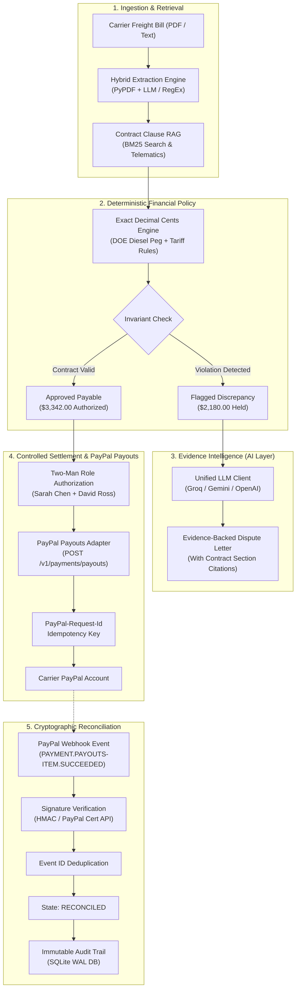

# FreightGuard
### Autonomous Freight Invoice Audit, Evidence Intelligence & PayPal Settlement
*Built for the PayPal AI Hackathon*

[](https://github.com/yatish-code26/PayPal.git)
[](https://developer.paypal.com/)
[](https://www.python.org/)
[](LICENSE)

---

## 1. Executive Summary & Product Vision

**FreightGuard** is an evidence-driven freight financial control tower engineered for third-party logistics providers (3PLs), freight brokers, enterprise shippers, and accounts-payable departments. Freight logistics is plagued by widespread invoice leakage—industry studies show 15–20% of all freight bills contain discrepancies ranging from unauthorized accessorial surcharges and off-tariff spot rates to duplicate dwell penalties.

The central product guarantee:
> *"Every freight charge must be explainable, every discrepancy must be evidenced, and every payout must pass deterministic financial controls."*

FreightGuard replaces manual, error-prone spot-checking with an end-to-end **Evidence-to-Settlement Control Loop**:
1. **Invoice Ingestion & Extraction**: Line-item breakdown of linehauls, fuel surcharges, detention, and accessorials from PDFs or raw text.
2. **Contract Intelligence (BM25 Clause Ranking)**: Relevance-ranked retrieval of Master Service Agreement (MSA) clauses, lane tariffs, and fuel index formulas.
3. **Telematics & Dock Verification**: Proof of delivery, bill of lading (BOL) profiles, and GPS geofence dwell logs.
4. **Deterministic Policy Validation**: Exact decimal cents arithmetic isolating verified payable balances from uncontracted charges.
5. **AI Dispute Intelligence & Synthesis**: Automated drafting of formal commercial dispute letters grounded in contract citations with Groq, Gemini, or OpenAI.
6. **Controlled PayPal Payout**: Two-man segregation of duties authorization and execution via PayPal Developer Platform Payouts (`POST /v1/payments/payouts`).
7. **Webhook-Driven Cryptographic Reconciliation**: Asynchronous state synchronization, idempotent replay protection, and append-only audit logging.

---

## 2. The $2,180 Signature Demonstration Scenario

Carrier: **Apex Global Freight Logistics**  
Invoice: `#INV-2025-88419` | Shipment: `#SH-884192` (BOL `#BOL-99214`)  
Contract: `AGF-MSA-2025-V2` | Lane: Chicago, IL (ORD) &rarr; Dallas, TX (DFW), 53ft Dry Van

| # | Line Item Description | Billed Amount | Contracted / Expected | Flagged Variance | Contract Clause & Evidence Authority |
|---|---|---|---|---|---|
| **1** | Linehaul Base Rate | $3,450.00 | $2,850.00 | **+$600.00** | **Clause 3.1**: Agreed lane tariff violated; carrier billed off-tariff spot rate. |
| **2** | Fuel Surcharge (FSC) | $722.00 | $342.00 | **+$380.00** | **Clause 4.2**: DOE Diesel Index $3.90/gal yields 12.0% on contracted base ($2,850); carrier billed 21.0% on uncontracted base. |
| **3** | Destination Liftgate Service | $350.00 | $0.00 | **+$350.00** | **Clause 6.4**: Unauthorized accessorial. BOL verifies dock-to-dock forklift facility; no pre-auth dispatch code on record. |
| **4** | Origin Facility Detention | $150.00 | $150.00 | **$0.00** | **Clause 6.8**: Telematics records 150 min dwell (30 billable min over 120 min free time) @ $300/hr = $150.00. Conforms. |
| **5** | Secondary Congestion Surcharge | $850.00 | $0.00 | **+$850.00** | **Rule DUP-01 & Clause 6.8**: Prohibited duplicate fee. Congestion already accounted for under Detention. |
| | **TOTALS** | **$5,522.00** | **$3,342.00** | **+$2,180.00** | **Accounting Invariant: $3,342.00 Approved + $2,180.00 Disputed = $5,522.00 Total Billed** |

Every dollar, cent, and calculation step is verified with zero floating-point arithmetic.

---

## 3. Architecture & Control Flow



---

## 4. Key Design Principles & Security Model

### A. The Golden Rule: Zero API Key Requirement
The application runs **100% offline out-of-the-box** using high-fidelity local simulations. No external account or credit card is required to inspect, test, or evaluate the application. When live API keys are provided in `.env` or supplied via the UI settings, the system seamlessly transitions into `LIVE_SANDBOX` mode.

### B. "AI Never Decides Money" Policy Guard
Large Language Models draft commercial correspondence and synthesize explanations, but **monetary calculations are 100% deterministic**. Any LLM output that attempts to adjust amounts or override calculations is intercepted and rejected by backend policy invariants.

### C. Financial Invariants
1. **Zero Float Arithmetic:** All monetary math is stored and calculated in integer cents.
2. **Reconciliation Equality:** `Total Billed == Approved Payable + Disputed Variance`.
3. **Segregation of Duties (Two-Man Signoff):** Payouts require dual authorization. The same user cannot sign off as both Approver 1 and Approver 2.
4. **Rate Limiting & Anti-Replay:** Sliding-window rate limiters protect financial endpoints. Webhooks enforce replay deduplication.

---

## 5. Quickstart Guide

### Prerequisites
- Python 3.11, 3.12, or 3.14
- Git

### Installation & Run

1. **Clone the repository:**
   ```bash
   git clone https://github.com/yatish-code26/PayPal.git
   cd PayPal
   ```

2. **Install dependencies:**
   ```bash
   pip install -r requirements.txt
   ```

3. **Run the test suite (Verify 21 tests pass):**
   ```bash
   python -m pytest -v
   ```

4. **Start the application:**
   ```bash
   python run_server.py
   ```
   *Windows PowerShell shortcut:*
   ```powershell
   .\run.ps1
   ```

5. **Open your browser:**
   Navigate to [http://localhost:8000](http://localhost:8000).

---

## 6. Docker & Container Deployment

To launch via Docker:
```bash
docker build -t freightguard .
docker run -p 8000:8000 freightguard
```

Or using Docker Compose:
```bash
docker compose up -d
```

---

## 7. Key REST API Endpoints

| Method | Endpoint | Description |
|:---|:---|:---|
| `GET` | `/healthz` | System health and active adapter mode check |
| `GET` | `/api/stats` | Executive control tower metrics (billed, payable, disputed) |
| `GET` | `/api/invoices` | Filtered invoice queue |
| `POST` | `/api/invoices/upload` | Upload PDF or text freight invoice for hybrid extraction |
| `POST` | `/api/invoices/{id}/audit` | Run autonomous deterministic contract audit |
| `GET` | `/api/ai/explain/{id}` | Plain-English AI explanation of audit findings |
| `POST` | `/api/disputes/generate` | Generate formal dispute letter with BM25 contract citations |
| `POST` | `/api/settlements/authorize` | Enforce two-man signoff and create settlement intent |
| `POST` | `/api/settlements/payout` | Execute PayPal Sandbox Payout with idempotency |
| `POST` | `/api/webhooks/paypal` | Authoritative PayPal webhook listener with signature verification |
| `GET` | `/api/settings` | Read safe diagnostic configuration and masked keys |
| `POST` | `/api/settings` | In-memory runtime credential configuration |

---

## 8. Verification & Test Suite

The test suite thoroughly verifies all security gates, financial invariants, and PayPal workflows:
```bash
python -m pytest -v
```

Expected output:
```
tests/test_ai_service.py ......................... PASSED [ 23%]
tests/test_invoices_audit.py ..................... PASSED [ 33%]
tests/test_policy_engine.py ...................... PASSED [ 52%]
tests/test_security_hardening.py ................. PASSED [ 80%]
tests/test_settlement_invariants.py .............. PASSED [ 95%]
tests/test_webhooks.py ........................... PASSED [100%]

============================= 21 passed in 1.33s ==============================
```

---

## 9. License

This project is licensed under the MIT License — see the [LICENSE](LICENSE) file for details.
