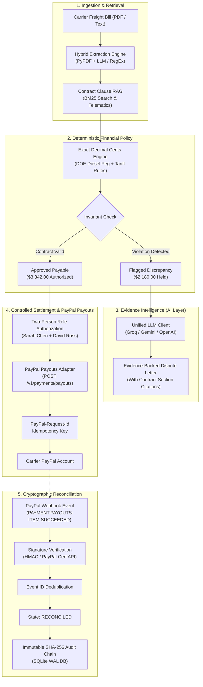

# FreightGuard
### Autonomous Freight Invoice Audit, Evidence Intelligence & Safe PayPal Settlement

[](https://github.com/yatish-code26/PayPal.git)
[](https://developer.paypal.com/)
[](https://www.python.org/)
[](LICENSE)

---

## 1. Executive Summary & Product Vision

**FreightGuard** is an evidence-driven freight financial control tower engineered for enterprise shippers, 3PL logistics brokers, and accounts payable teams. In North American and global logistics, freight spend exceeds **$800 Billion annually**, yet between **15% and 20% of all freight bills contain billing errors**, unauthorized accessorial fees, off-tariff spot rates, or duplicate dwell penalties.

The central product guarantee:
> *"Every freight charge must be explainable, every discrepancy must be evidenced, and every payout must pass deterministic financial controls."*

FreightGuard replaces manual, error-prone spot-checking with an autonomous **Evidence-to-Settlement Control Loop**:
1. **Invoice Ingestion & Extraction**: Line-item breakdown of linehauls, fuel surcharges, detention, and accessorials from PDFs or raw text via a unified extraction pipeline.
2. **Contract Intelligence (BM25 Clause Ranking)**: Relevance-ranked retrieval of Master Service Agreement (MSA) clauses, lane tariffs, and DOE fuel peg formulas.
3. **Telematics & Dock Verification**: Proof of delivery, bill of lading (BOL) profiles, and GPS geofence dwell logs.
4. **Deterministic Policy Engine**: Exact decimal cents arithmetic isolating verified payable balances from uncontracted charges.
5. **AI Dispute Intelligence**: Automated drafting of formal commercial dispute letters grounded in cited contract clauses (Groq, Gemini, or OpenAI with local fallback).
6. **"Pay Now, Hold the Rest" Settlement**: Immediate disbursement of undisputed freight to maintain carrier relationships, holding disputed charges in reserve pending dispute resolution.
7. **Controlled PayPal Payouts**: Two-person segregation of duties authorization and execution via PayPal Developer Platform Payouts (`POST /v1/payments/payouts`).
8. **Cryptographic Reconciliation & Audit**: Webhook-driven status synchronization, replay deduplication, and an append-only SHA-256 hash-chained audit log.

---

## 2. 120-Second Demo Video & Presentation Guide

FreightGuard includes a standalone, low-MB **120-second (2:00) MP4 demo video** with embedded on-screen subtitles:
- **Video File:** [`freightguard-demo.mp4`](freightguard-demo.mp4) (located directly in the project root, ~3.1 MB, 1080p-compatible H.264 MP4).
- **Embedded Subtitles:** Each slide features synchronized on-screen broadcast subtitles across 8 progressive chapters covering the full lifecycle.
- **Generate / Re-render Video:** Run `python generate_demo_video.py` anytime to synthesize or re-render the video.
- **Narration Script:** Complete spoken voiceover script with exact timestamp cues is available in [`docs/demo-video-script.md`](docs/demo-video-script.md).
- **Subtitles File:** Standalone YouTube-ready subtitle file is available in [`docs/demo-video-subtitles.srt`](docs/demo-video-subtitles.srt).

---

## 3. The $2,180 Signature Demonstration Scenario

Carrier: **Apex Global Freight Logistics**  
Invoice: `#INV-2025-88419` | Shipment: `#SH-884192` (BOL `#BOL-99214`)  
Contract: `AGF-MSA-2025-V2` | Lane: Chicago, IL (ORD) &rarr; Dallas, TX (DFW), 53ft Dry Van

| # | Line Item Description | Billed Amount | Contracted / Expected | Flagged Variance | Contract Clause & Evidence Authority |
|---|---|---|---|---|---|
| **1** | Linehaul Base Rate | $3,450.00 | $2,850.00 | **+$600.00** | **Clause 3.1**: Agreed lane tariff violated; carrier billed off-tariff spot rate. |
| **2** | Fuel Surcharge (FSC) | $722.00 | $342.00 | **+$380.00** | **Clause 4.2**: DOE Diesel Index $3.90/gal yields 12.0% on contracted base ($2,850); carrier billed 21.0% on uncontracted base. |
| **3** | Destination Liftgate Service | $350.00 | $0.00 | **+$350.00** | **Clause 6.4**: Unauthorized accessorial. BOL verifies dock-to-dock forklift facility; no pre-auth dispatch code on record. |
| **4** | Origin Facility Detention | $150.00 | $150.00 | **$0.00** | **Clause 6.8**: Telematics records 150 min dwell (30 billable min over 120 min free time) @ $300/hr = $150.00. Conforms. |
| **5** | Secondary Congestion Surcharge | $850.00 | $0.00 | **+$850.00** | **Rule DUP-01 & Clause 6.8**: Prohibited duplicate fee. Congestion already accounted for under Detention. |
| | **TOTALS** | **$5,522.00** | **$3,342.00** | **+$2,180.00** | **Accounting Invariant: $3,342.00 Approved + $2,180.00 Disputed = $5,522.00 Total Billed** |

Every dollar, cent, and calculation step is verified with zero floating-point arithmetic.

---

## 4. Architecture & Control Flow



---

## 5. Key Design Principles & Security Model

### A. The Golden Rule: Zero API Key Requirement
The application runs **100% offline out-of-the-box** using high-fidelity local simulations. No external account or credit card is required to inspect, test, or evaluate the application. When live API keys are provided in `.env` or supplied via the UI settings, the system seamlessly transitions into `LIVE_SANDBOX` mode.

### B. "AI Never Decides Money" Policy Guard
Large Language Models draft commercial correspondence and synthesize explanations, but **monetary calculations are 100% deterministic**. Any LLM output that attempts to adjust amounts or override calculations is intercepted and rejected by backend policy invariants.

### C. Financial Invariants & Segregation of Duties
1. **Zero Float Arithmetic:** All monetary math is stored and calculated in integer cents.
2. **Reconciliation Equality:** `Total Billed == Approved Payable + Disputed Variance + Held Reserve`.
3. **Segregation of Duties (Two-Person Signoff):** Payouts require dual authorization. The same user cannot sign off as both Approver 1 and Approver 2.
4. **Rate Limiting & Anti-Replay:** Sliding-window rate limiters protect financial endpoints. Webhooks enforce replay deduplication.

---

## 6. Standout Features

1. **"Pay Now, Hold the Rest" Settlement**: Splits invoices into verified payable balances paid immediately via PayPal Payouts and reserves held in escrow pending dispute resolution.
2. **"Ask FreightGuard" Natural-Language Assistant**: Conversational assistant grounded directly in the SQLite database and Master Service Agreement clauses.
3. **Carrier Scorecards & Renewal Intelligence**: Computes historical error rates, average overcharge, recurring violation patterns, and automated renewal negotiation talking points.
4. **Tamper-Evident SHA-256 Audit Trail**: Hash-chained event log where each record cryptographically links to the previous block. One-click verification validates whole-chain integrity.
5. **One-Click Dispute PDF Export**: Generates formal, pure-Python commercial dispute packets with zero external binary dependencies.
6. **Cross-Invoice Anomaly & Duplicate Detection**: Flags duplicate billings across shipments (same PO/BOL within 48 hours) and off-tariff rate drift.

---

## 7. Quickstart Guide (Run With Zero Errors)

### Prerequisites
- Python 3.10, 3.11, 3.12, or 3.14
- Git

### Installation & Run Steps

1. **Clone the repository:**
   ```bash
   git clone https://github.com/yatish-code26/PayPal.git
   cd PayPal
   ```

2. **(Recommended) Create a virtual environment:**
   - *Windows PowerShell:*
     ```powershell
     python -m venv .venv
     .\.venv\Scripts\Activate.ps1
     ```
   - *Linux / macOS:*
     ```bash
     python -m venv .venv
     source .venv/bin/activate
     ```

3. **Install dependencies:**
   ```bash
   pip install -r requirements.txt
   ```

4. **Verify the test suite (All 33 tests pass):**
   ```bash
   python -m pytest -v
   ```

5. **Start the application:**
   ```bash
   python run_server.py
   ```
   *Windows PowerShell shortcut:*
   ```powershell
   .\run.ps1
   ```

6. **Open your browser:**
   Navigate to [http://localhost:8000](http://localhost:8000).

---

## 8. Environment Variables Reference

| Variable | Description | Default |
|:---|:---|:---|
| `FREIGHTGUARD_MODE` | Operational mode: `LOCAL_DEMO` or `LIVE_SANDBOX` | `LOCAL_DEMO` |
| `PAYPAL_CLIENT_ID` | PayPal Developer Platform Sandbox Client ID | `""` |
| `PAYPAL_CLIENT_SECRET` | PayPal Developer Platform Sandbox Client Secret | `""` |
| `PAYPAL_WEBHOOK_ID` | PayPal Webhook ID for live webhook verification | `""` |
| `AI_PROVIDER` | LLM Provider: `LOCAL_DETERMINISTIC`, `GROQ`, `GEMINI`, `OPENAI` | `LOCAL_DETERMINISTIC` |
| `GROQ_API_KEY` | Groq API Key (uses `llama-3.3-70b-versatile`) | `""` |
| `GEMINI_API_KEY` | Gemini API Key (uses `gemini-2.0-flash`) | `""` |
| `OPENAI_API_KEY` | OpenAI API Key (uses `gpt-4o-mini`) | `""` |
| `SESSION_SECRET` | Secret key for signed JWT/itsdangerous user session tokens | Configured default |
| `WEBHOOK_LOCAL_HMAC_SECRET` | Local secret key for simulated webhook HMAC signatures | Configured default |
| `CORS_ALLOWED_ORIGINS` | Comma-separated allowed frontend origins | `http://localhost:8000,...` |

---

## 9. REST API Endpoints Reference

| Method | Endpoint | Description |
|:---|:---|:---|
| `GET` | `/healthz` | System health and active adapter mode check |
| `GET` | `/api/stats` | Unified dashboard metrics and attention triage queue |
| `GET` | `/api/invoices` | Filtered invoice queue |
| `POST` | `/api/invoices/upload` | Upload PDF or text freight invoice for hybrid extraction |
| `POST` | `/api/invoices/{id}/audit` | Run autonomous deterministic contract audit |
| `GET` | `/api/ai/explain/{id}` | Plain-English AI explanation of audit findings |
| `POST` | `/api/disputes/generate` | Generate formal dispute letter with BM25 contract citations |
| `POST` | `/api/disputes/{id}/resolve` | Resolve dispute upon credit note receipt and release held reserve |
| `GET` | `/api/disputes/{id}/export-pdf` | Stream formal commercial dispute notice as a clean PDF |
| `POST` | `/api/settlements/authorize` | Enforce two-person signoff and create settlement intent |
| `POST` | `/api/settlements/payout` | Execute PayPal Sandbox Payout with idempotency |
| `POST` | `/api/settlements/pay-now-hold-rest` | Split settlement: pay undisputed, hold disputed variance |
| `POST` | `/api/webhooks/paypal` | Authoritative PayPal webhook listener with signature verification |
| `GET` | `/api/carriers/scorecards` | Carrier performance metrics and renewal negotiation talking points |
| `POST` | `/api/chat/ask` | Natural-language query answering grounded in SQLite data |
| `GET` | `/api/anomalies` | Cross-invoice duplicate shipments and rate drift detector |
| `GET` | `/api/audit-events/verify-integrity` | Cryptographic SHA-256 hash-chain verification across all audit records |
| `GET` | `/api/settings` | Read safe diagnostic configuration and masked keys |
| `POST` | `/api/settings` | In-memory runtime credential configuration |

---

## 10. Verification & Test Suite

The test suite verifies all security gates, financial invariants, demo video generation, and PayPal workflows:
```bash
python -m pytest -v
```

Expected output:
```
tests/test_ai_service.py ......................... PASSED
tests/test_dashboard_reconciliation.py ........... PASSED
tests/test_demo_video.py ......................... PASSED
tests/test_invoices_audit.py ..................... PASSED
tests/test_phase4_features.py .................... PASSED
tests/test_policy_engine.py ...................... PASSED
tests/test_security_hardening.py ................. PASSED
tests/test_settlement_invariants.py .............. PASSED
tests/test_webhooks.py ........................... PASSED

============================= 35 passed in 2.10s ==============================
```

---

## 11. Disclosures & Attribution

- **AI Tools Disclosures:** This project integrates with Groq (Llama 3.3 70B), Google Gemini (Gemini 2.0 Flash), and OpenAI (GPT-4o-mini) for commercial dispute letter drafting and unstructured invoice extraction.
- **Financial Architecture:** All dollar calculations and payout amounts are strictly evaluated by a deterministic Python policy engine with zero LLM financial authority.
- **License:** Licensed under the MIT License — see the [LICENSE](LICENSE) file for details.
